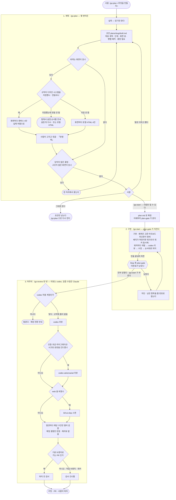
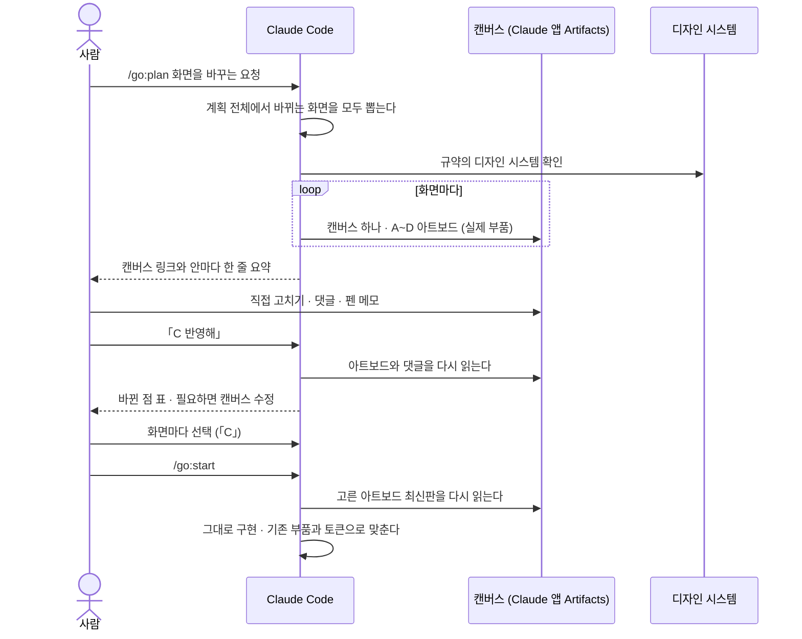
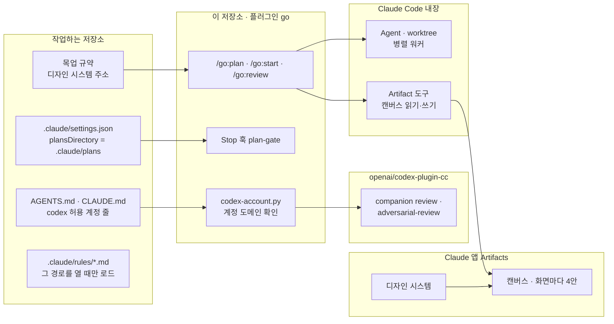
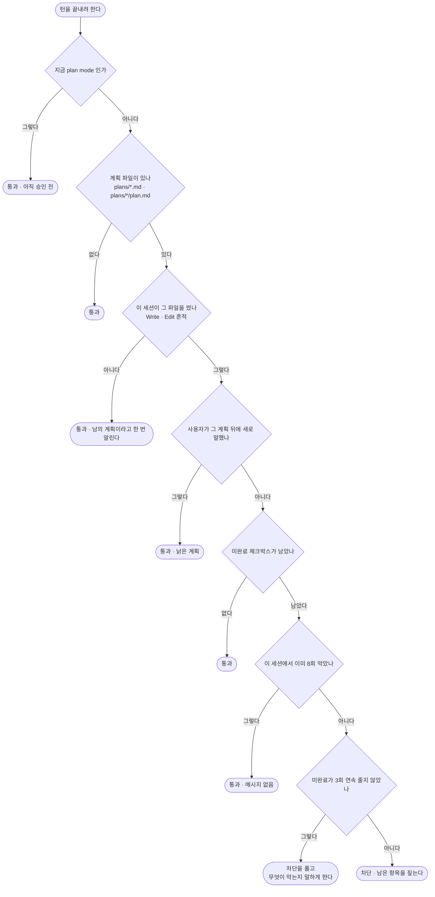

# go-skill

Claude Code 로 개발할 때 「계획 → 구현 → 리뷰 → 반영」을 굴리는 최소 구성이다.
이 저장소가 제공하는 것은 플러그인 `go` 하나이고, 명령 셋과 Stop 훅 하나가 들어 있다.

| 명령 | 하는 일 | Claude 가 스스로 부르나 |
|---|---|---|
| `/go:plan <요청>` | 코드를 실측하고 초안(`.claude/plans/<slug>/draft.md`)을 쓴다. 계획 전체에서 바뀌는 화면을 먼저 모두 뽑아 화면마다 목업 4안(A~D)을 만들고, 결정과 목업 선택을 실행 전에 모두 닫는다. 사용자가 더하고 빼는 대로 몇 번이든 고친다. 코드는 고치지 않는다 | 예 (「계획 세워줘」) |
| `/go:start` | **승인.** 초안을 `plan.md` 로 확정하고 구현한다(병렬 배치는 워크트리 워커로 동시에 · 워커마다 codex 리뷰). 고른 목업이 화면의 명세다. 끝나면 `/go:review` 를 부르고 보고한다 | **아니오 — 사람만 친다** |
| `/go:review` | 마무리 한 사이클: codex 계정 확인 → codex 리뷰(민감 영역이면 adversarial 추가) → web 이면 슬롭 스캔 → 해당 구간만 열어 검증 → 확정 결함만 반영 → 머지 전 검사(기본 브랜치로 가는 PR 만) → 커밋·PR | 예 (`/go:start` 와 워커가 부른다) |
| Stop 훅 (plan-gate) | 확정된 `plan.md` 에 미완료 체크박스가 남았는데 턴을 끝내려 하면 거부한다 | 자동 |

`/go:start` 에 `disable-model-invocation` 을 걸어 둔 것이 「승인은 사람만 한다」의 구조다. 말로 「시작해」라고 해도 `/go:plan` 은
구현하지 않고 「`/go:start` 를 쳐 주세요」라고 답한다. 리뷰는 OpenAI 의 공식 codex 플러그인([openai/codex-plugin-cc](https://github.com/openai/codex-plugin-cc))이 맡는다.

## 되는 것 — 확인 기록 (2026-10-13 · 1.2.0)

한 실제 저장소에서 계획 하나를 처음부터 끝까지 돌리며 확인했다. 「확인」 칸은 무엇을 돌려서 봤는지다.

| 되는 것 | 어떻게 쓰나 | 확인 |
|---|---|---|
| 마켓플레이스에서 받기 | `/plugin marketplace add jwjinn/go-skill` → `/plugin install go@jwjinn-go-skill`(리뷰용 codex 플러그인도 함께 — [설치](#설치)) | 빈 설정 폴더에서 처음부터 설치: 스킬 셋(`plan` · `start` · `review`)과 Stop 훅 하나가 등록된다. 매 세션에 늘 붙는 비용은 약 185토큰 |
| 계획 세우기 · 다듬기 | `/go:plan <요청>` → 초안을 말로 고친다. 결정은 한 자리에서 묻는다 | 결정 셋을 한 번에 묻고 닫은 9단계 초안을 썼다 |
| 실행(사람만) | `/go:start` | 같은 계획을 끝까지 실행하고 PR 을 올렸다. Claude 가 스스로는 부르지 못한다 |
| 멈추지 않고 완주 | 확정된 `plan.md` 의 체크박스를 Stop 훅이 지킨다 | 시험 82/82. 실제 실행 중 미완료 단계가 남은 종료를 한 번 막았다 |
| 병렬 작업 | 초안의 「병렬 배치」 절에 파일 집합이 겹치지 않는 묶음을 적으면 `/go:start` 가 배치마다 워크트리 서브에이전트를 띄운다 | 워크트리 격리 서브에이전트가 별도 폴더 · 별도 브랜치로 뜨는 것을 확인했다. 배치 둘 이상을 나눠 돌리는 전체 흐름은 아직 실측 전이다 |
| 화면 목업 4안 → 고르기 → 고친 것 반영 | 화면을 바꾸는 계획이면 `/go:plan` 이 화면마다 캔버스 하나에 A~D 를 그린다. 캔버스에서 직접 고치고 Claude Code 에서 「C 반영해」 | 저장소 디자인 시스템의 실제 부품으로 그린 캔버스를 만들고, 사람이 고친 판 · 펜 메모 · 고른 아트보드를 다시 읽어 왔다. 연동이 빠졌거나 캔버스가 안 보이면 멈추고 설정을 안내한다 |
| 리뷰 | `/go:review`(또는 `/go:start` 가 부른다) — codex 하나 · 민감 영역이면 adversarial 추가 | codex 일반 리뷰와 adversarial 리뷰가 같은 결함 하나를 짚었고, 확인 뒤 반영했다. 계정 확인 스크립트 자기 시험 통과 |
| 작업 브랜치는 빠르게 | 머지 전 검사는 기본 브랜치로 가는 PR 에서만 돈다. 작업 브랜치 PR 은 codex 리뷰만 | 기본 브랜치 PR 에서 저장소 머지 전 검사가 돌고, 워커 · 작업 브랜치 호출에서는 건너뛴다 |
| 머지 뒤 정리 | squash 머지한 브랜치 끝에 표시 커밋을 남기고, 기본 브랜치를 체크아웃한 로컬 워크트리를 빨리 감기로 맞춘다 | PR 둘에 적용. 미커밋 변경이 같은 파일을 건드린 로컬 체크아웃 두 곳은 손대지 않고 멈춰 막는 파일을 보고했다 |

---

## 사용법

### 화면이 없는 기능

```
1) /go:plan 대시보드 폴링을 줄이고 그 효과를 잰다
   → 실측하고 초안을 보여 준다. 결정할 것이 있으면 한 자리에서 묻는다
2) 「이것도 넣어」「저건 빼」 — 그냥 말하면 초안만 바뀐다. 다음 날 이어서 하려면 인자 없이 /go:plan
3) /go:start → plan.md 확정 → 구현. 끝낸 항목은 [x] 로 닫히고, 남은 채로는 턴이 끝나지 않는다
4) 구현이 끝나면 /go:start 가 /go:review 를 부른다(codex 리뷰 → 검증·반영 → 검사 → PR)
5) 최종 보고 첫 절에 「무엇이 어떻게 구현됐나」가 결론으로 나온다(판정 문구 없음). 충족 여부는 사람이 판단하고 PR 을 머지한다.
   머지까지 맡기려면 /go:start --merge
```

### 화면을 새로 만들거나 고치는 기능

```
1) /go:plan 알림 화면에 필터를 추가하고 새 리포트 화면을 만든다
   → 초안의 「화면」 표에 바뀌는 화면이 모두 뽑힌다(알림 · 리포트)
   → 화면마다 캔버스 하나에 A~D 4안이 그려진다. 링크를 열어 본다
2) 캔버스에서 직접 고친다(문구 · 위치 · 크기 · 색). 요소에 댓글이나 펜 메모를 남겨도 된다
3) Claude Code 로 돌아와 「C 반영해」 → 고친 판과 댓글을 다시 읽어 바뀐 점을 표로 정리하고, 필요하면 캔버스를 고친다
4) 화면마다 하나를 고른다(「알림은 C, 리포트는 B」). 모든 화면이 골라져야 /go:start 가 확정한다
5) /go:start → 고른 아트보드의 최신판을 다시 읽어 명세로 구현한다. 실행 중에는 화면 때문에 멈추지 않는다
```

캔버스는 저장소의 목업 규약이 Claude Design 디자인 시스템을 지정했을 때 쓴다. 그렇지 않으면 4안을 로컬 HTML 로 만든다
(`.claude/plans/<slug>/mockups/<화면>/index.html`). 연동이 빠져 있으면 `/go:plan` 이 무엇이 빠졌는지와 설정 순서를 안내하고
멈춘다([캔버스 연동 설정](#캔버스-연동-설정)).

### 계획 없이 한 작은 수정

「리뷰 돌려」 또는 `/go:review`. 세션이 끊겼으면 `/go:start` 를 인자 없이 치면 남은 단계를 이어간다.
멈추게 하려면 계획 파일을 지우거나 체크박스를 전부 닫는다. 범위 밖으로 뺀 항목은 `[x]` 로 위장하지 말고 줄을 지운다.

---

## 개발 흐름



사람은 앞(무엇을 만들지, 화면 선택, 계획 승인)과 뒤(PR)에 있다. 결정과 화면 선택을 실행 전에 모두 닫기 때문에, 실행 중에는
멈추지 않고 끝까지 간다. 중간을 지탱하는 것은 Stop 훅 하나다.

---

## 화면 목업 루프



- 사람이 캔버스에서 고친 것이 정본이다. Claude 는 덮어쓰지 않고 그 위에 더한다.
- 새로 그린 것처럼 보이는 부분은 구현할 때 기존 부품과 토큰으로 맞추고, 맞출 수 없으면 묻는다.
- 디자인 시스템은 평소에 손대지 않는다. 부품 코드가 바뀌었을 때만 `/design-sync` 로 다시 올린다. 방향은 코드에서 디자인 시스템 쪽 하나다.

### 캔버스 연동 설정

캔버스를 쓰려면 아래가 모두 갖춰져야 한다. 하나라도 빠지면 `/go:plan` 이 이 순서를 안내하고 멈춘다.

| 순서 | 할 일 | 누가 |
|---|---|---|
| 1 | Claude Code 를 claude.ai 조직 계정으로 로그인한다(`/login`) | 사용자 |
| 2 | Organization settings › Artifacts 에서 Artifacts · Design systems · Design 을 켠다 | 조직 소유자 |
| 3 | 작업 저장소에서 `/design-login` 뒤 `/design-sync` 로 부품을 디자인 시스템으로 올린다 | 사용자가 시작 |
| 4 | Claude 앱 Artifacts 페이지에서 Migrate team design systems 를 누른다(옛 claude.ai/design 프로젝트를 옮긴다). 부품을 다시 올린 뒤에는 Claude Design 메뉴의 Migrate again | 사용자 |
| 5 | 그 디자인 시스템의 Artifact 주소를 저장소 목업 규약에 적는다. 조직 기본 디자인 시스템이 따로 있어도 규약에 적은 것을 쓴다 | 저장소 |
| 6 | 디자인 시스템과 캔버스를 조직에 공유하거나, 늘 그것을 만든 계정으로 로그인한다. 아티팩트는 기본이 비공개라 Claude Code 가 다른 계정으로 로그인하면 「찾을 수 없음」이 되고 `/go:plan` 이 멈춘다. 로그인은 같은 기계의 모든 세션이 같이 쓰므로, 한 세션에서 `/login` 으로 계정을 바꾸면 다른 세션도 바뀐다. 의심되면 `claude auth status` 의 email 을 본다 | 사용자 |

---

## 무엇이 어디에 있나



| 자리 | 무엇을 두나 | 왜 거기인가 |
|---|---|---|
| `AGENTS.md` / `CLAUDE.md` | 빌드 명령 · 불변식 · 반복 함정 · `codex 허용 계정: @<도메인>` 줄 | 매 세션 전부 로드된다. 공식 문서는 파일당 200줄 미만을 권한다 |
| 목업 규약(저장소 docs) | 디자인 시스템 Artifact 주소 · 목업에 들어갈 것 | `/go:plan` 이 CLAUDE.md · `.claude/rules/` 에서 「목업」으로 찾아 연다 |
| `.claude/rules/*.md` | 특정 경로에서만 필요한 규칙(`paths:` frontmatter) | 그 경로의 파일을 열 때만 로드된다 |
| `.claude/review-rules.md` | 이 저장소에서 반복된 결함과 심각도 기준 | 리뷰 전에 읽는다 |
| `docs/` | 절차의 사연·이력 | 로드되지 않는다. 필요할 때 연다 |

---

## plan-gate 가 판정하는 방식



`/go:plan` 의 초안은 `draft.md` 라서 게이트가 보지 않는다. `/go:start` 가 `plan.md` 를 쓰는 순간부터 본다.

완화 장치를 그대로 두었다. 없으면 사람이 훅을 끄고, 그러면 게이트가 통째로 사라진다.

- plan mode 인 동안은 막지 않는다. Stop 입력의 `permission_mode` 가 `"plan"` 이면 통과한다
- 세션당 상한 8회(`CLAUDE_PLAN_GATE_MAX`). 그 뒤로는 메시지 없이 통과한다
- 미완료가 3회 연속 줄지 않으면 차단을 풀고 「무엇이 막고 있나」를 말하게 한다
- 훅 자체가 고장 나면 통과한다. 다만 `jq` 가 없어서 아무것도 못 본 경우에는 그 사실을 알린다
- 이 세션이 쓴 계획만 막는다. 같은 워크트리의 다른 세션 계획에는 걸리지 않는다
- 판별할 수 없으면(transcript 부재 등) 차단을 유지한다. 모르는 것을 근거로 열면 게이트가 무력해진다

---

## 설치

```
# go (명령 셋 + Stop 훅)
/plugin marketplace add jwjinn/go-skill
/plugin install go@jwjinn-go-skill

# 교차 모델 리뷰
/plugin marketplace add openai/codex-plugin-cc
/plugin install codex@openai-codex
/codex:setup                     # Review Gate 는 켜지 않는다
```

작업하는 저장소에 둘 것:

```json
// .claude/settings.json — plan-gate 가 보는 자리
{ "plansDirectory": ".claude/plans" }
```

```markdown
<!-- AGENTS.md 또는 CLAUDE.md — 리뷰 계정을 묶고 싶을 때만 -->
codex 허용 계정: @example.com
```

화면 목업을 캔버스로 받으려면 [캔버스 연동 설정](#캔버스-연동-설정)을 마친다.

| 도구 | 구분 | 없으면 |
|---|---|---|
| `bash` · `git` | 필수 | plan-gate 가 계획 파일과 워크트리를 찾지 못한다 |
| `jq` | 필수 | 게이트가 아무것도 보지 못한다. 통과하되 그 사실을 알린다 |
| `python3` | 계정 확인에 필요 | 「codex 허용 계정」 줄이 있으면 리뷰 전에 멈춘다 |
| `codex` CLI (ChatGPT 로그인) | 리뷰에 필요 | `/codex:setup` 이 설치와 로그인을 안내한다 |

⚠ `.claude/` 는 Claude Code 의 보호 경로다. `default`·`acceptEdits` 모드에서는 계획 파일을 쓸 때 확인창이 뜨고,
`bypassPermissions` 에서는 허용된다.

개발 기계에서는 이 저장소를 심링크로 걸면 푸시 없이 바로 반영된다. 마켓플레이스 설치와 심링크를 동시에 두면 같은 훅이
두 번 돈다. 하나만 둔다.

```bash
ln -sfn "$PWD/plugins/go" ~/.claude/skills/go
claude plugin list               # go@skills-dir 가 보이면 된다
```

---

## 운영 규칙

- 한 단계에 리뷰는 한 사이클이다. 반복 리뷰에서 좋은 결과를 얻지 못했다. 머지 직전의 합본 리뷰 1회는 생략하지 않는다.
- 리뷰어는 codex 하나다. Claude 리뷰어를 함께 돌리면 리뷰마다 Claude 토큰이 한 세션분 더 든다(2026-10-11). Claude 는 codex 발견을
  해당 구간만 열어 검증하고 고치는 역할만 한다. codex 가 실패하면 조용히 Claude 리뷰로 바꾸지 않고 사용자에게 묻는다.
- codex 가 혼자 찾은 결함은 코드를 열어 확인한 뒤에만 반영한다. 교차 모델 리뷰는 대칭이 아니라는 보고가 있다(arXiv 2607.21656, 프리프린트).
- codex 모델은 `~/.codex/config.toml`(Orca 세션은 `$CODEX_HOME`)의 `model` 을 쓴다. 바꾸려면 companion 에 `--model` 을 넘긴다.
- `/codex:rescue` 는 기본이 쓰기 모드다. 조사 용도로만 쓴다.
- 새 훅 · 스킬 · 스크립트는 같은 실패가 두 번 기록된 뒤에만 만든다. 첫 번째는 기록 한 줄로 끝낸다.
- 머지한 뒤에는 두 가지를 한다(어느 경로로 머지했든). squash 로 넣었으면 작업 브랜치 끝에 「squash 머지됨 — #번호(머지 커밋)」 빈 커밋을
  남겨 push 하고, 기본 브랜치를 체크아웃한 워크트리를 `pull --ff-only` 로 맞춘다. 막히면 남의 변경을 stash 하지 않고 막는 파일을 보고한다.

---

## 검증

| 날짜 | 부품 | 결과 |
|---|---|---|
| 2026-10-11 | `plan-gate` | 미완료 1개를 남긴 채 끝내려 하자 3회 차단했고, 그 뒤 「진전 없음」으로 차단을 풀었다. 대조군 82/82 |
| 2026-10-11 | codex 리뷰 | 심은 결함 둘(SQL 문자열 보간 · off-by-one)을 모두 찾았다. 없는 모델 이름이면 실패해서 모델 지정이 실제로 전달됨을 확인했다 |
| 2026-10-12 | `/go:plan` → `/go:start` | 새 세션에서 초안만 쓰고 멈춤 · 말로 「시작해」에는 구현하지 않음 · `/go:start` 가 끝까지 감(39턴) |
| 2026-10-12 | 목업 4안(로컬 HTML) | 4안과 비교 페이지 생성 · 고르기 전 `/go:start` 는 확정하지 않음 · 고른 안을 명세로 구현 |
| 2026-10-13 | 목업 4안(캔버스) | 디자인 시스템 부품으로 화면 하나의 4안을 그렸고, 사람이 캔버스에서 고친 판과 펜 메모를 다시 읽어 왔다 |
| 2026-10-13 | `codex-account.py` | 대조군 4개(허용 · 대소문자 · 다른 도메인 · 로그인 없음) 통과 |

---

## 이력

2026-10-10 에 예전 체인(go-review · go-tester · go-fanout · go-coder, 실행 코드 약 6,000줄과 지시문 약 2,000줄)을 이 구성으로
줄였다. 그 체인을 쓰던 저장소의 60일 기록에서 체인 자체를 고친 커밋이 39 중 18, 리뷰 발견 1,763건 중 사람이 판정한 것이 16건이었다.
가치가 확인된 것은 둘이었다. 문맥이 다른 리뷰어가 다른 결함을 찾는다는 것과, 승인된 계획이 1단계에서 멈추는 일을 훅이 막는다는 것이다.
앞의 것은 codex 플러그인이 맡고, 이 저장소에는 뒤의 것과 명령 셋만 남겼다. 2026-10-24 이후 같은 저장소에서 PR 당 캐시 읽기 토큰을
다시 재서, 30% 이상 줄지 않으면 해당 단계만 되돌린다.

2026-10-13 — 머지 전 검사를 기본 브랜치로 가는 PR 에서만 돌린다. 작업 브랜치는 빠르게 가고, 검사는 기본 브랜치에 들어갈 때
한 번 한다. 같은 판정으로 `--merge` 는 기본 브랜치면 squash, 작업 브랜치끼리면 merge 커밋으로 머지하고, PR 은 `--base` 를 넘겨 연다.

2026-10-13 — 머지 뒤 두 가지를 더했다. squash 머지한 작업 브랜치에 표시 커밋을 남기고(브랜치 `git log` 맨 위에서 머지됐음이 보인다),
기본 브랜치를 체크아웃한 로컬 워크트리를 빨리 감기로 맞춘다.

`plugins/` 아래의 예전 플러그인 넷은 지우지 않고 그대로 둔다. 마지막 활성 상태는 태그
[`archive/go-chain-2026-10-10`](https://github.com/jwjinn/go-skill/tree/archive/go-chain-2026-10-10) 에 있다. `go` 를 쓰면서
`go-review` 를 다시 걸면 완주 훅이 두 번 돈다. 되살릴 때는 `go` 를 먼저 내린다.

---

## 라이선스

MIT
